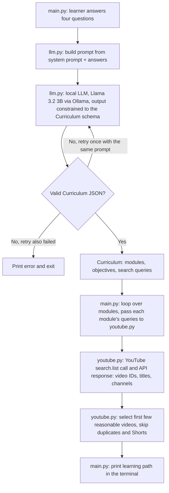
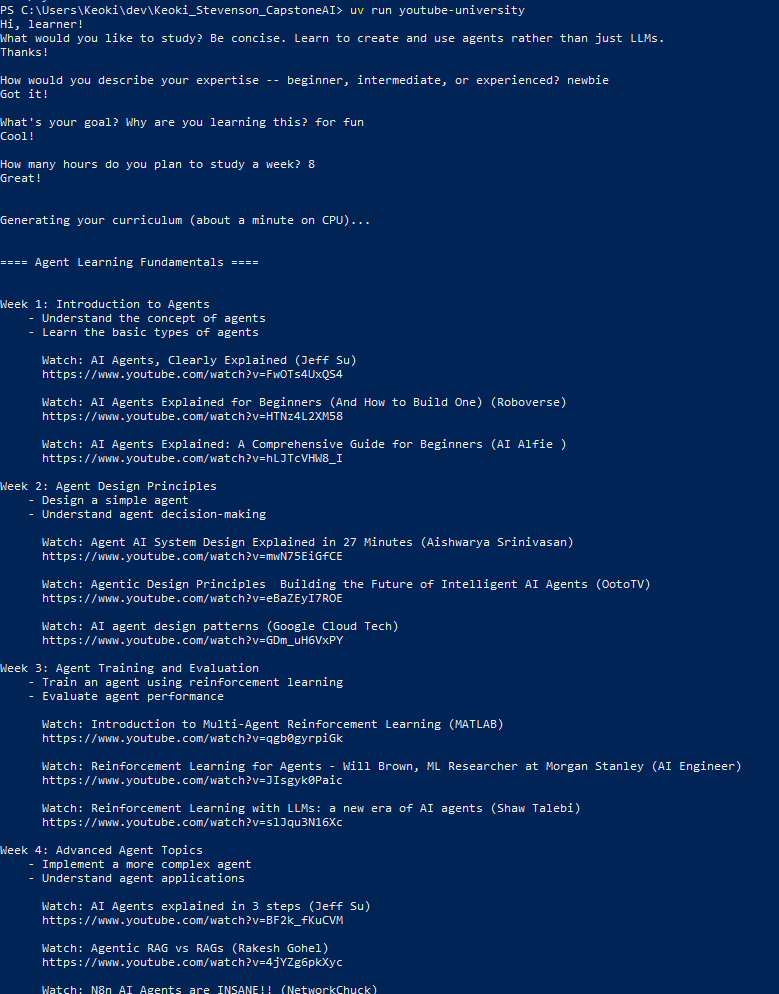
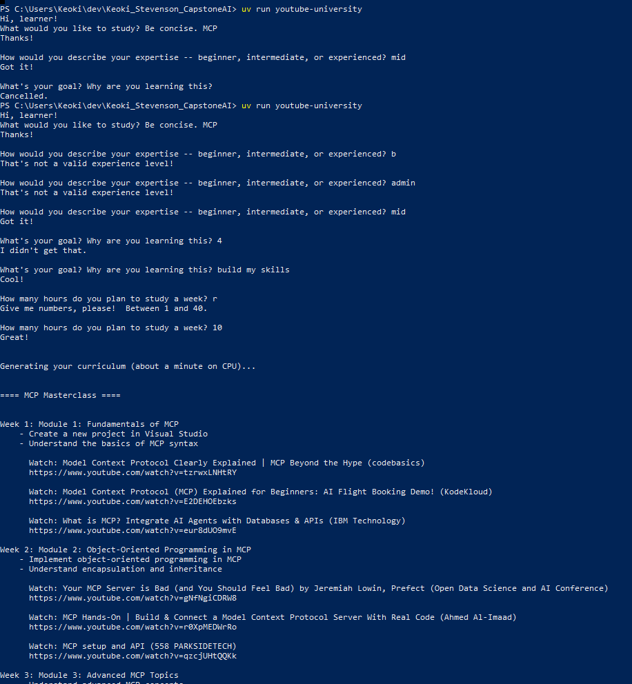

# LearningPath AI

LearningPath AI turns a learner's topic, experience level, goal, and weekly study time into a four-week curriculum of real YouTube videos. A local language model designs the curriculum; the YouTube Data API supplies the videos.

> **Project status:** Version 1 (curriculum generation and YouTube video discovery) is complete and runs end to end. Version 2 (saved learning paths and transcript-grounded Q&A) is in development on the `v2-rag` branch.

Built for the CAP 942 AI Application Development capstone. The Python package is still named `youtube_university`, the project's original name.

## Overview

**Problem.** Free video tutorials exist for almost any subject, but self-taught learners have to decide on their own what to study, in what order, and which videos to watch. Searching YouTube topic by topic produces a pile of videos, not a plan.

**Solution.** The learner answers four questions in the terminal. A local LLM (Llama 3.2 3B, running in Ollama) produces a structured, four-module curriculum with learning objectives and YouTube search queries. The app runs those queries against the YouTube Data API and prints a week-by-week learning path with real, clickable videos.

**Intended users.** Self-taught learners and career changers who study with free online videos and want a structured starting point.

## Features

| Feature | How it works | Uses the LLM? |
| --- | --- | --- |
| Learner profile | Four validated questions: topic, level (beginner, intermediate, experienced; common synonyms accepted), goal, hours per week (1–40) | No |
| Curriculum generation | The model returns exactly four progressive modules, each with a title, 2–3 action-verb objectives, and 2 YouTube search queries | **Yes** |
| Structured output | Ollama constrains the response to the `Curriculum` JSON schema; Pydantic validates it; one automatic retry if it doesn't match | Yes (validated in code) |
| Video search | Each module's search query is sent to the YouTube Data API | No |
| Video selection | Up to 3 videos per module, skipping duplicates across modules and YouTube Shorts | No |
| Learning path output | Week-by-week modules, objectives, and video titles, channels, and links in the terminal | No |
| Error handling | Friendly messages when Ollama isn't running, the model's answer can't be used, YouTube is unreachable, or the API key is missing | No |

**AI versus conventional code.** The language model does one job: it designs the curriculum and writes search queries. Python code handles input validation, API requests, video selection, and output. Video titles, channels, and links always come from the YouTube Data API, never from the model, so the model cannot invent a video, channel, or URL.

## Workflow



## Architecture

```
src/youtube_university/
├── llm.py       Ollama integration: model, prompt, Curriculum schema, generate_curriculum()
├── youtube.py   YouTube integration: API key, search_youtube(), find_videos()
└── main.py      Orchestration and user interface: ask_learner(), print_path(), main()
```

Three rules keep the design simple:

1. **`main.py` is the only file that talks to the user** and the only one that knows the whole flow.
2. **`llm.py` and `youtube.py` never import each other.** `main.py` passes plain data between them: each module's search queries go to YouTube as a plain list of strings.
3. **Each integration file owns its library's failures.** `llm.py` handles Ollama and validation errors, `youtube.py` handles network and API errors, and both raise a `RuntimeError` with a friendly message that `main.py` prints.

| # | Stage | File | Function | Input | Output | Done by |
| --- | --- | --- | --- | --- | --- | --- |
| 1 | Collect input | `main.py` | `ask_learner()` | Keyboard | Profile dict | Code |
| 2 | Build prompt | `llm.py` | `build_prompt()` | Profile | Prompt text | Code |
| 3 | LLM call | `llm.py` | `generate_curriculum()` | Prompt + schema | Validated `Curriculum` | **LLM**, then Pydantic |
| 4 | Orchestration | `main.py` | `main()` | `Curriculum` | One search per module | Code |
| 5 | YouTube call | `youtube.py` | `search_youtube()` | Query | Raw result items | YouTube API |
| 6 | Selection | `youtube.py` | `find_videos()` | Queries | Up to 3 video dicts | Code |
| 7 | Output | `main.py` | `print_path()` | Modules + videos | Terminal text | Code |

## Tools and libraries

- **Python 3.14**, managed with **uv**
- **Ollama**, running **Llama 3.2 3B** (`llama3.2:3b`) locally on the CPU
- **ollama** (Python client), **pydantic** (schema and validation), **requests** (YouTube API calls), **python-dotenv** (loads the API key from `.env`)
- **YouTube Data API v3** (`search.list`)

## Data source

V1 uses the **YouTube Data API v3** `search.list` endpoint, requesting videos only. From each result it keeps the **video ID, title, and channel name**.

**Preprocessing:** HTML entities in titles and channel names (for example, `&#39;` becomes an apostrophe) are decoded, and each watch URL is built from the video ID. For each module, the first search query is sent (up to 5 results); the app keeps up to 3 videos, skipping any video already chosen for another module and any title marked `#shorts`.

**No database in V1.** Nothing is stored; every run generates a fresh curriculum and searches YouTube again.

## Setup

These steps are for Windows PowerShell; macOS and Linux work the same way with the matching installers.

1. **Install uv:**
   ```powershell
   powershell -ExecutionPolicy ByPass -c "irm https://astral.sh/uv/install.ps1 | iex"
   ```
2. **Install Ollama** from [ollama.com](https://ollama.com), start it, and download the model (about 2 GB):
   ```powershell
   ollama pull llama3.2:3b
   ```
3. **Create a YouTube API key.** In the [Google Cloud Console](https://console.cloud.google.com/), create or select a project, enable **YouTube Data API v3**, and create an API key under **Credentials**. The key and the enabled API must be in the same project.
4. **Clone the repository and add your key:**
   ```powershell
   git clone https://github.com/keokistevenson/Keoki_Stevenson_CapstoneAI
   cd Keoki_Stevenson_CapstoneAI
   Copy-Item .env.example .env
   ```
   Open `.env` and replace `your_key_here` with your key.

   **Security:** `.env` is Git-ignored. Never commit it or put a real key in `.env.example`, which should contain only the placeholder.
5. **Install dependencies.** uv downloads Python 3.14 if needed:
   ```powershell
   uv sync
   ```

## Run

Make sure Ollama is running, then from the project root:

```powershell
uv run youtube-university
```

Answer the four questions. Generating the curriculum takes about a minute on a CPU.

## Sample runs

### Example 1 — Beginner Learning Path
**Learner inputs:**
- Topic: Learn to create and use agents rather than just LLMs
- Experience: newbie (accepted as beginner)
- Goal: for fun
- Study time: 8 hours/week

The application generated a four-week learning path with
learning objectives and YouTube video recommendations.



### Example 2 — Input Validation
**Learner inputs:**
- Topic: Learn to create and use agents rather than just LLMs
- Experience: mid (accepted as intermediate,)
- Goal: build my skills
- Study time: 10 hours/week

The application generated a four-week learning path with
learning objectives and YouTube video recommendation



## Testing

V1 was tested manually, end to end, from the terminal.

| Test | Expected behavior | Result |
| --- | --- | --- |
| Complete run with valid answers | Four modules, objectives, and up to 3 videos per module | Pass |
| Empty topic, or a goal of 3 characters or fewer | Prompt repeats until a valid answer is given | Pass |
| Level synonyms (`newbie`, `mid`, `senior`) and invalid levels | Synonyms map to beginner, intermediate, or experienced; others are rejected | Pass |
| Hours outside 1–40, or not a number | Prompt repeats with an explanation | Pass |
| Ollama not running | "Cannot reach Ollama. Is it running?" instead of a traceback | Pass |
| Missing `YOUTUBE_API_KEY` | App exits with "YOUTUBE_API_KEY is missing. Check your .env file." | Pass |
| Ctrl+C during a run | "Cancelled." instead of a traceback | Pass |

## Challenges and lessons learned

- **The retry loop called the model twice.** Code that should have run after the loop was indented inside it, so every run took about two minutes. Lesson: in Python, indentation decides what a loop repeats.
- **API keys can leak through error messages.** Network errors from `requests` can include the full URL, which contains the key. The app raises its own message with `from None` and never prints the request URL.
- **Google Cloud settings belong to a project.** The key and the enabled API were in different projects at first; enablement and keys are per project.
- **The model drifted off the learner's goal.** A curriculum for "Python for spreadsheets" gained an unrelated deployment module. Adding "Stay focused on the learner's goal" to the prompt addressed it.
- **The model invents a curriculum for gibberish.** Input like `fas asdfwedvszc44` produced a confident plan. Schema validation checks the shape of the answer, not its meaning; this is documented as a limitation.
- **CPU-only generation is slow.** A 3B model takes about a minute per curriculum; the low temperature (0.2) and schema constraint keep the output consistent enough that one retry is usually sufficient.
- **API quota.** Each search costs 100 of the default 10,000 daily units, so the app sends one query per module (`QUERIES_PER_MODULE = 1`).

## Limitations

- A small local model can misjudge topics, drift from the goal, or accept meaningless input.
- Videos are chosen from search metadata (title and channel) only; nobody has reviewed their content or quality.
- Results depend on YouTube's search ranking and change over time.
- The daily API quota limits how many learning paths can be generated per day.
- Nothing is saved between runs.

## Next steps (Version 2)

Version 2, in development on the `v2-rag` branch, adds saved learning paths and lets learners ask questions about the videos in their path. Answers are grounded in indexed video transcripts (retrieval-augmented generation with `nomic-embed-text` embeddings and a local Qdrant vector database), with timestamped links to the source videos.

## Attribution

Built with Llama. Llama 3.2 is licensed under the Llama 3.2 Community License, Copyright © Meta Platforms, Inc., and runs locally through Ollama.

Video content belongs to its creators. Version 1 retrieves video metadata through the YouTube Data API and links to the original videos; it does not download videos or train models. Version 2 uses locally provided transcripts for retrieval-augmented question answering.

Author: Keoki Stevenson
