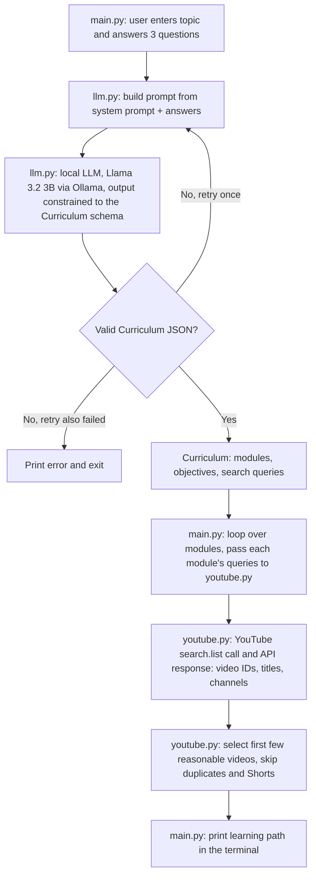

# YouTubeU: Simplified Plan (3 files, cache later)

**Goal:** a working Version 1 in 4–5 hours that you can explain end to end, where the file structure itself shows the architecture. Anything that doesn't teach or demonstrate the flow was cut.

```
User input → prompt → local LLM → structured curriculum → orchestration logic
           → YouTube API call → API response → video selection → learning path
```

## 0. Where you are

**Done:** Ollama + `llama3.2:3b` (about 15 tokens/s measured), uv project, dependencies (`ollama`, `pydantic`, `requests`, `python-dotenv`, `pytest`), YouTube key in `.env` (Git-ignored), GitHub repo published.
**Not done:** any application code.

**No new setup.** The code goes in the package `uv` already created: `src/youtube_university/`. Leave the generated `__init__.py` alone for now.

---

## 1. Architecture: three files, one more later

```
src/youtube_university/
├── llm.py       Ollama integration: model, prompt, Curriculum schema, generate_curriculum()
├── youtube.py   YouTube integration: API key, search_youtube(), find_videos() (selection)
├── main.py      Orchestration + user interface: ask_learner(), main() loop, print_path()
└── cache.py     LATER, NICE TO HAVE: JSON cache that youtube.py calls
```

```
main.py ──imports──▶ llm.py
   └─────imports──▶ youtube.py ──(later)──▶ cache.py
```

**Rules that make this architecture real (and are your answers when asked to explain it):**
1. **`main.py` is the only file that talks to the user** (`input`/`print`) and the only one that knows the whole flow.
2. **`llm.py` and `youtube.py` never import each other.** The LLM side doesn't know YouTube exists, and the YouTube side doesn't know an LLM exists. `main.py` hands plain data between them: the curriculum's search queries go in as a plain `list[str]`.
3. **Each integration file owns its library's failure modes.** `llm.py` catches Ollama and validation problems, `youtube.py` catches `requests` and API problems, and both raise a plain `RuntimeError` with a friendly message. `main.py` only catches `RuntimeError`, so it never imports `ollama` or `requests`. There is no exception hierarchy.
4. **No other files.** There is no `models.py`, `config.py`, or `errors.py`. The `Curriculum` schema lives in `llm.py` because it is the LLM's output contract, and constants sit at the top of the file that uses them. Add a file only when two files genuinely need to share something.

**Run commands** (from the project root; the `-m` form is required because the files use relative imports):
```powershell
uv run python -m youtube_university.llm      # test the LLM file on its own
uv run python -m youtube_university.youtube  # test the YouTube file on its own
uv run python -m youtube_university.main     # run the whole app
```

---

## 2. What is required and what is not

| Item | Label | Why |
|---|---|---|
| App runs end to end without errors | **REQUIRED FOR CAPSTONE** | Rubric: Functional Application (210 pts) |
| One open-source LLM (Llama 3.2 3B via Ollama) | **REQUIRED FOR CAPSTONE** | Minimum requirement |
| Accepts user input; produces LLM-generated output | **REQUIRED FOR CAPSTONE** | Minimum requirement |
| Readable code with comments/docstrings; sensible structure | **REQUIRED FOR CAPSTONE** | Rubric: readability, structure, in-code documentation |
| Proposal, 1–2 pages | **REQUIRED FOR CAPSTONE** | Rubric: Proposal (60 pts) |
| Written documentation (overview, tools, architecture, features, challenges) | **REQUIRED FOR CAPSTONE** | Rubric: Documentation (30 pts) |
| Workflow diagram | **REQUIRED FOR CAPSTONE** | Rubric: accurate diagram |
| Data/input source note (YouTube Data API) | **REQUIRED FOR CAPSTONE** | Deliverable 3, since the app uses an external source |
| 5–10 minute presentation + demo | **REQUIRED FOR CAPSTONE** | Deliverable 4 |
| GitHub repo with instructions; Canvas submission | **REQUIRED FOR CAPSTONE** | Submission requirements |
| A few recorded real runs | **REQUIRED FOR CAPSTONE** | Evidence that it "runs end-to-end" |
| 3 follow-up questions, 1 LLM call, structured curriculum | **REQUIRED FOR WORKING MVP** | The core flow |
| YouTube search per module query | **REQUIRED FOR WORKING MVP** | The core flow |
| First 2–3 reasonable results per module | **REQUIRED FOR WORKING MVP** | Simple selection |
| Basic error handling (Ollama down, YouTube error, bad JSON) | **REQUIRED FOR WORKING MVP** | So the demo doesn't crash |
| `cache.py` (JSON cache with expiry) | **NICE TO HAVE** | About 45–60 min. Add only if the MVP and polish are done. |
| Save output to a Markdown file | **NICE TO HAVE** | About 10 minutes |
| Video duration (extra `videos.list` call) | **NICE TO HAVE** | About 20 minutes |
| 2–3 `pytest` tests | **NICE TO HAVE** | The rubric doesn't require automated tests |
| Scoring/ranking, `rich` formatting | **NICE TO HAVE** | Skip unless everything else is done |
| Transcripts, embeddings, vector DB, RAG, persistent library, GUI | **VERSION 2** | Do not build |

**Confirmed safe to cut (none are in the rubric):** ranking, custom exception classes, a large test suite, extra architecture layers, Markdown export, persistence.

---

## 3. The flow you need to be able to explain

| # | Stage | File | Function (you write it) | Goes in | Comes out | Who does the work |
|---|---|---|---|---|---|---|
| 1 | Collect input | `main.py` | `ask_learner()` | keyboard | profile dict | Your code |
| 2 | Build prompt | `llm.py` | `build_prompt()` | profile | prompt text | Your code |
| 3 | LLM call | `llm.py` | `generate_curriculum()` | prompt + schema | validated `Curriculum` | **LLM** (Ollama), then Pydantic validates |
| 4 | Orchestration | `main.py` | `main()` loop | `Curriculum` | one search per module's queries | Your code |
| 5 | YouTube call | `youtube.py` | `search_youtube()` | query string | raw JSON items | **YouTube API** |
| 6 | Selection | `youtube.py` | `find_videos()` | queries | 2–3 simple video dicts | Your code |
| 7 | Output | `main.py` | `print_path()` | modules + videos | terminal text | Your code |

**The key idea:** the LLM never sees YouTube, and YouTube never sees the LLM. `main.py` is the glue. The LLM produces *search queries* (text), not videos, so it can't invent a video.

---

## 4. Python notes for a C#/.NET developer (only the surprises)

- **Type hints are not enforced at runtime.** `def f(x: int)` accepts a string without complaint. Pydantic is where real validation happens.
- **`dict` ≈ `Dictionary<string, object>`**, and JSON maps onto `dict`/`list` directly. A Pydantic `BaseModel` ≈ a DTO with validation (like `JsonSerializer.Deserialize` plus data annotations).
- **A `.py` file is a module, and a folder with `__init__.py` is a package** (≈ namespace + assembly). `from .llm import X` is a *relative import*: "from the `llm` module next to me."
- **`None` ≈ `null`.** An empty string is "falsy" (`if not value:` catches both).
- **`if __name__ == "__main__":`** ≈ `Main()`. Code under it runs only when you execute that file directly. That's how each file can be tested on its own.
- **f-strings** ≈ interpolated strings. **Slicing:** `items[:3]` ≈ `Take(3)`.
- **Objects are passed by reference.** A `set` you pass into a function can be changed by it (we use this on purpose in Checkpoint 4).
- **`raise X from None`** hides the original exception. We use it so an error message can't leak a URL containing your API key.
- **Indentation is syntax**, and `try/except` ≈ `try/catch`. Catch specific exceptions.

---

## 5. Checkpoints

For every step: what we're building, why, what goes in, what comes out, and how it connects. **Answer the "Check yourself" questions to me in chat before moving on.**

**Commit rule:** one small commit per checkpoint. Add by explicit path so `.env` can never be included:
```powershell
git add src/youtube_university
git commit -m "feat: <what you just built>"
git push
```

### Checkpoint 1: Ollama works from Python (~20 min)

**Step 1.1: `llm.py` with `ask_llm()`**
- **Building:** the smallest possible wrapper around the local model.
- **Why:** it proves the whole chain (Python → `ollama` library → Ollama server → model) before anything else depends on it. This is the first piece of the LLM-integration file.
- **In:** a prompt string. **Out:** the model's reply as a string.
- **Connects:** nothing comes before it except the Ollama server running (check the tray icon). It grows into `generate_curriculum()` in Checkpoint 3.

Create `src/youtube_university/llm.py`:

```python
# src/youtube_university/llm.py
"""Everything that talks to the local LLM (Ollama)."""
import ollama

MODEL = "llama3.2:3b"


def ask_llm(prompt: str) -> str:
    """Send one prompt to the local model and return its reply as text."""
    response = ollama.chat(
        model=MODEL,
        messages=[{"role": "user", "content": prompt}],  # a conversation = list of {role, content}
    )
    return response.message.content


if __name__ == "__main__":  # like Main(): runs only when you execute this file directly
    print(ask_llm("In one sentence, what is a curriculum?"))
```

Run: `uv run python -m youtube_university.llm`. The first run may take 10–30 seconds while the model loads.

**Try (2 min):** add `{"role": "system", "content": "Answer like a pirate."}` as the first message. Then add `options={"temperature": 0}` to `chat()` and run twice. Compare.

**Check yourself**
1. `ollama.chat()` returns quickly in code but the work happens elsewhere. What process does it talk to, and how?
2. What are the roles in `messages`, and what does `system` do that `user` doesn't?
3. Why was the first run slower than the second?

**Done when:** you get a sensible reply and can answer the questions. Commit: `feat: call Ollama from llm.py`.

---

### Checkpoint 2: Python can call YouTube and get real videos (~30 min)

**Step 2.1: `youtube.py` with `search_youtube()`**
- **Building:** one function that calls YouTube's `search.list` endpoint.
- **Why:** this is the only way the app gets real videos. We prove it works on its own before the LLM is involved. It is a separate file because it is a separate integration with different failure modes.
- **In:** a search query string. **Out:** the raw list of result items from the API.
- **Connects:** in Checkpoint 4, the LLM's search queries reach this function via `find_videos()`.

Create `src/youtube_university/youtube.py`:

```python
# src/youtube_university/youtube.py
"""Everything that talks to the YouTube Data API."""
import json
import os

import requests
from dotenv import load_dotenv

load_dotenv()                                # copies key=value lines from .env into environment variables
YOUTUBE_KEY = os.getenv("YOUTUBE_API_KEY")   # None (null) if missing
SEARCH_URL = "https://www.googleapis.com/youtube/v3/search"


def search_youtube(query: str, max_results: int = 5) -> list[dict]:
    """Call YouTube search.list for one query and return the raw result items."""
    try:
        resp = requests.get(
            SEARCH_URL,
            params={                          # requests URL-encodes this dict for you
                "part": "snippet",
                "q": query,
                "type": "video",
                "maxResults": max_results,
                "key": YOUTUBE_KEY,
            },
            timeout=10,                       # without a timeout, a network problem can hang forever
        )
    except requests.RequestException:
        # `from None` hides the original error: its text can contain the URL, which contains your key
        raise RuntimeError("Could not reach YouTube. Check your internet connection.") from None
    if resp.status_code != 200:
        # TODO: read Google's message from resp.json()["error"]["message"] and raise
        #       RuntimeError with it. Never include resp.url in the message.
        raise NotImplementedError
    return resp.json()["items"]


if __name__ == "__main__":   # test this file alone: uv run python -m youtube_university.youtube
    items = search_youtube("python tutorial for beginners")
    print(json.dumps(items[0], indent=2))     # look at the raw structure once
    for item in items:
        video_id = item["id"]["videoId"]
        print(item["snippet"]["title"], "->", f"https://www.youtube.com/watch?v={video_id}")
```

Run it **once or twice only**. Each search costs **100 quota units** out of 10,000 per day.

**If it fails:** `API key not valid` means the `.env` value is wrong or still the placeholder. A message saying the API "has not been used in project... or it is disabled" means YouTube Data API v3 isn't enabled in the `youtube-university` project.

**Check yourself**
1. What fields does one result contain, and where is the video ID? Which useful fields (like duration) are *missing*?
2. Why does `requests.get(..., params={...})` beat building the URL string by hand?
3. Why do we raise `RuntimeError` here instead of letting the `requests` exception escape?
4. A run with 4 modules and 1 query each costs how many quota units?

**Done when:** you see real titles and working links. Commit: `feat: search YouTube from youtube.py`.

---

### Checkpoint 3: User input → LLM → curriculum (~80 min). The core of the project.

**Step 3.1: the schema, in `llm.py`**
- **Building:** two small Pydantic classes describing the JSON we want back.
- **Why:** they do two jobs at once. They tell Ollama what shape to produce, and they validate what came back.
- **In:** nothing. **Out:** a JSON schema (to the LLM) and a validator (for the response).
- **Connects:** `generate_curriculum()` uses both, and `main.py` will import `Curriculum` for type hints.

```python
from pydantic import BaseModel, ValidationError


class Module(BaseModel):            # like a C# DTO: the SHAPE we want the LLM to return
    title: str
    objectives: list[str]
    search_queries: list[str]


class Curriculum(BaseModel):
    title: str
    modules: list[Module]
```

**Step 3.2: the prompt, in `llm.py`**
- **Building:** a system prompt and a prompt-builder function.
- **Why:** the model only knows what's in the text we send. All "personalization" is just text.
- **In:** the profile dict. **Out:** a prompt string.
- **Connects:** takes the output of `ask_learner()` (Step 3.4) and feeds `generate_curriculum()`.

```python
SYSTEM_PROMPT = (
    "You are a curriculum designer for self-taught learners who study with free YouTube videos. "
    "Respond only with JSON matching the requested structure. "
    "Never invent video titles, channels, or URLs; only propose search queries."
)


def build_prompt(profile: dict) -> str:
    # TODO: write the user prompt as an f-string. Include:
    #   - the learner's topic, level, goal, and hours per week (from `profile`)
    #   - "exactly 4 modules, ordered so each builds on the last, each sized for about one week"
    #   - per module: a short title, 2-3 objectives that start with an action verb, 2 search queries
    #   - query rules: 3-8 words, searchable, no channel names
    #   - a plain-English description of the fields (title, modules, objectives, search_queries)
    raise NotImplementedError
```

**Step 3.3: `generate_curriculum()`: the one LLM call, in `llm.py`**
- **Building:** send the prompt to the model, get JSON back, validate it, and turn every failure into a friendly `RuntimeError`.
- **Why:** this is the AI step: topic and learner info in, structured plan out. It is the whole job of `llm.py`.
- **In:** the profile dict. **Out:** a validated `Curriculum` object.
- **Connects:** its output drives the YouTube searches in `main.py`.

```python
def generate_curriculum(profile: dict) -> Curriculum:
    """One LLM call: learner profile in, validated Curriculum out."""
    messages = [
        {"role": "system", "content": SYSTEM_PROMPT},
        {"role": "user", "content": build_prompt(profile)},
    ]
    for attempt in range(2):                         # first try + one retry
        try:
            response = ollama.chat(
                model=MODEL,
                messages=messages,
                format=Curriculum.model_json_schema(),   # constrains the output to this JSON shape
                options={"temperature": 0.2},            # low = more consistent
            )
        except ConnectionError:   # TODO: stop Ollama and verify this is the exception you really get
            raise RuntimeError("Cannot reach Ollama. Is it running?") from None
        except ollama.ResponseError as err:              # for example, the model isn't downloaded
            raise RuntimeError(f"Ollama error: {err.error}") from None
        text = response.message.content                  # a STRING containing JSON, not an object yet
        # TODO: parse and validate with Curriculum.model_validate_json(text) and return it.
        #       On ValidationError, print a short note and let the loop try again.
    # TODO: after both attempts fail, raise RuntimeError with a clear message
```

Once this works, delete `ask_llm()` (or keep it for experiments).

**Step 3.4: `main.py` with `ask_learner()` and a temporary `main()`**
- **Building:** the user-facing side: collect the topic plus 3 follow-up questions.
- **Why:** the answers are the personalization inputs to the prompt. It lives in `main.py` because only `main.py` talks to the user.
- **In:** keyboard. **Out:** a dict like `{"topic", "level", "goal", "hours_per_week"}`.
- **Connects:** its dict goes straight into `generate_curriculum()`.

```python
# src/youtube_university/main.py
"""Orchestration: ask the user, call the LLM, call YouTube, print the result."""
from .llm import generate_curriculum      # relative import: the llm.py next to this file


def ask_learner() -> dict:
    # TODO (about 15 lines; nothing new for you): ask
    #   (1) what do you want to learn?  (2) level: beginner / some / experienced
    #   (3) your goal in one sentence   (4) hours per week
    # Re-ask on empty or invalid answers. Return the four answers as a dict.
    raise NotImplementedError


def main() -> None:           # TEMPORARY: we'll replace this in Checkpoint 5
    profile = ask_learner()
    print("\nGenerating your curriculum (about a minute on CPU)...")
    curriculum = generate_curriculum(profile)
    print(curriculum.model_dump_json(indent=2))


if __name__ == "__main__":
    main()
```

Run: `uv run python -m youtube_university.main`. If you see "attempted relative import", you ran the file directly instead of with `-m`.

**Step 3.5: evaluate like a user.** Time the call (expect roughly 30–90 seconds on your CPU). Are the modules in a sensible order? Would you type those search queries into YouTube? Change one thing in the prompt, rerun, and note what changed. That is your prompt-engineering evidence for the docs.

**Check yourself**
1. What does `format=Curriculum.model_json_schema()` do, and what does it *not* guarantee?
2. If the output is already schema-constrained, why do we still validate?
3. Why do we tell the model "never invent video titles or URLs", and what in the design makes that rule hold even if the model ignores it?
4. Where does the LLM's job end and your code's job begin?
5. Why is `ask_learner()` in `main.py` and `build_prompt()` in `llm.py`?

**Done when:** three different topics give valid, sensible curricula. Commit: `feat: generate structured curriculum with local LLM`.

---

### Checkpoint 4: Curriculum queries automatically call YouTube (~45 min)

**Step 4.1: `find_videos()` in `youtube.py`**
- **Building:** given a few search queries, call YouTube and pick a few videos.
- **Why:** this is where the LLM's text output becomes real, clickable results, and where "video selection" happens.
- **In:** a list of query strings and a set of video IDs already used. **Out:** a list of small dicts (`title`, `channel`, `url`).
- **Connects:** `main.py` will pass it `module.search_queries`. It takes plain strings, **not** the LLM's `Module` type, so `youtube.py` doesn't depend on `llm.py`.

```python
VIDEOS_PER_MODULE = 3


def find_videos(queries: list[str], seen_ids: set[str]) -> list[dict]:
    """Search YouTube with each query and return a few simple video dicts."""
    videos = []
    for query in queries:
        for item in search_youtube(query):
            video_id = item["id"]["videoId"]
            title = item["snippet"]["title"]
            # TODO: skip the item if video_id is already in seen_ids, or if the title looks like junk
            #       (decide your rule; start with: contains "#shorts", ignoring case)
            # TODO: add video_id to seen_ids; append {"title", "channel", "url"} to videos
            # TODO: stop once len(videos) == VIDEOS_PER_MODULE
    return videos
```

`seen_ids` is a set shared across all modules. It's passed by reference, so each call adds to it and a video can't appear in two modules.

**Step 4.2: test it alone.** Change the `__main__` block at the bottom of `youtube.py` to:
```python
if __name__ == "__main__":
    print(find_videos(["python for beginners"], set()))
```
No LLM, no waiting. Run it once or twice. **Optional experiment (100 units):** add `"videoDuration": "medium"` to the search params and see what changes, and what you'd lose.

**Check yourself**
1. What is the contract between the LLM's output and `find_videos()`? What must be true of `search_queries` for this to work?
2. Why does `find_videos()` take `list[str]` instead of a `Module`?
3. "First 3 reasonable results" quietly trusts something. What? Name two ways it can pick a bad video.
4. Why pass `seen_ids` in instead of creating it inside the function?

**Done when:** a test query returns 2–3 real, distinct videos. Commit: `feat: select videos from YouTube search results`.

---

### Checkpoint 5: Complete end-to-end YouTubeU (~50 min)

**Step 5.1: `print_path()` in `main.py`**
- **Building:** formats the finished learning path for the terminal.
- **Why:** output is how the user experiences everything above.
- **In:** the `Curriculum` and a list of `(module, videos)` pairs. **Out:** printed text (module title, objectives, then each video's title and URL).
- **Connects:** last step of the flow. You write this one. Show "No videos found" for an empty module.

**Step 5.2: the real `main()`: the orchestration**
- **Building:** the function that runs the whole flow in order.
- **Why:** this is the "application logic" between the LLM and YouTube. It is not AI; it is plain sequencing, and the only place that knows both integrations exist.
- **In:** nothing (it asks the user). **Out:** the learning path on screen.

```python
import sys

from .llm import Curriculum, generate_curriculum
from .youtube import YOUTUBE_KEY, find_videos

QUERIES_PER_MODULE = 1     # each query costs 100 YouTube quota units, so keep this at 1 while developing


def main() -> None:
    if not YOUTUBE_KEY:
        sys.exit("YOUTUBE_API_KEY is missing. Check your .env file.")
    try:
        profile = ask_learner()
        print("\nGenerating your curriculum (about a minute on CPU)...")
        curriculum = generate_curriculum(profile)
        seen_ids: set[str] = set()
        results = []
        for module in curriculum.modules:
            # TODO: call find_videos with the first QUERIES_PER_MODULE queries of this module
            #       (slice: module.search_queries[:QUERIES_PER_MODULE]) and seen_ids;
            #       append (module, videos) to results
            pass
        print_path(curriculum, results)
    except RuntimeError as err:      # raised with friendly messages by llm.py and youtube.py
        print(err)
    except KeyboardInterrupt:
        print("\nCancelled.")
```

**Testing the loop without waiting for the LLM:** temporarily build a `Curriculum` by hand in `main.py` (one `Module` with one query) and use it instead of `generate_curriculum()`. Remove it afterward.

**Step 5.3: run it three times** with three different topics. Save each full terminal output in a notes file; those are your sample runs for the README. Then, to run the app by name, change the `[project.scripts]` line in `pyproject.toml` to `youtube-university = "youtube_university.main:main"` and test `uv run youtube-university`.

**Check yourself (explain it back in your own words, naming the file and function at each stage):**
1. Walk me through one run from the keyboard to the printed path.
2. Which stages use the LLM? Which call the YouTube API? Which are only your code?
3. If the LLM returned garbage twice, what does the user see? If the internet is down? If Ollama is stopped? Which file raised each message?
4. Why does `main.py` catch only `RuntimeError` and not `ollama` or `requests` exceptions?

**Done when:** three topics produce a complete printed learning path, and Ctrl+C, Ollama stopped, and an empty answer don't produce a traceback. Commit: `feat: end-to-end learning path generation`. **Tag the MVP:** `git tag v0.1-mvp` then `git push --tags`.

---

## 6. MVP schedule (4–5 hours)

| Checkpoint | Time | Running total |
|---|---|---|
| 1. Ollama from Python (`llm.py`) | 20 min | 0:20 |
| 2. YouTube from Python (`youtube.py`) | 30 min | 0:50 |
| 3. Input → LLM → curriculum (`llm.py` + `main.py`) | 80 min | 2:10 |
| 4. Queries → YouTube (`find_videos`) | 45 min | 2:55 |
| 5. End to end + basic errors (`main.py`) | 50 min | 3:45 |
| Slack for debugging | 15–75 min | 4:00–5:00 |

These are estimates, not measurements. The two places most likely to run over are Checkpoint 3 (prompt iteration, with a 30–90 second model wait on every test) and the first YouTube call. If you pass 5 hours with Checkpoint 5 unfinished, stop adding anything and finish only the core flow.

**Quota rule:** each full run costs `modules × queries × 100` units, so 400 with the default settings. Test `find_videos` on its own and use a hand-built curriculum for anything that doesn't need the LLM.

---

## 7. Checkpoint 6: Submission polish (do only after Checkpoint 5 works)

### 7.1 Minimum testing (~30 min) **[REQUIRED FOR CAPSTONE]**
The rubric asks that the app "runs end-to-end without errors" and suggests testing with realistic inputs. Run these by hand and record the result of each in a table:

| # | Test | Expected |
|---|---|---|
| 1 | Realistic technical topic (for example, Python for data analysis) | Full path, 4 modules, videos in each |
| 2 | Non-technical topic (for example, beginner guitar) | Works, videos are lessons |
| 3 | Vague topic ("stuff") | No crash |
| 4 | Empty answer to a question | Re-asks |
| 5 | Ollama stopped | Friendly message |
| 6 | Wrong key in `.env` (restore it afterward) | Friendly message, no key printed |

Fix only what breaks the demo.

### 7.2 README / final documentation (~60 min) **[REQUIRED FOR CAPSTONE]**
One README can serve as the supporting project document. It needs:
- [ ] Overview: purpose, problem, intended users
- [ ] Workflow diagram (Section 8 below)
- [ ] Tools and libraries: Python, Ollama, Llama 3.2 3B, `ollama`, `pydantic`, `requests`, `python-dotenv`, `uv`
- [ ] Architecture description: the three-file table and dependency rules from Section 1, plus the flow table from Section 3
- [ ] Features and how the LLM powers each (curriculum generation is the LLM feature; search and selection are plain code)
- [ ] Data source: YouTube Data API v3, which fields you use (video ID, title, channel), the selection rule, and "no database in V1: nothing is stored"
- [ ] Setup and run instructions: install `uv` and Ollama, `ollama pull llama3.2:3b`, create a YouTube key, copy `.env.example` to `.env`, `uv sync`, `uv run youtube-university`
- [ ] 2–3 sample runs (from Checkpoint 5)
- [ ] Challenges and lessons learned (use your real notes: prompt changes, CPU wait times, quota, Windows setup)
- [ ] Limitations: small model, metadata-only selection, videos not reviewed, quota
- [ ] "Built with Llama" attribution

### 7.3 Proposal (~30 min) **[REQUIRED FOR CAPSTONE]**
Reuse text from Sections 2, 3, 6, and 7 of your earlier `implementation_plan.md` (problem, why it matters, tools, workflow). Shorten it to 1–2 pages and describe the simple V1 you actually built.

### 7.4 Presentation (~60 min including one timed rehearsal) **[REQUIRED FOR CAPSTONE]**
About 8 minutes, 6 slides: (1) problem, (2) what the app does, (3) workflow diagram, (4) architecture: the three files and where the LLM is used, (5) **live demo** (the model takes about a minute, so explain the prompt and schema while you wait), (6) challenges and next steps (Version 2). Record a 60–90 second backup video of a good run.

### 7.5 Fresh-clone check and submit (~20 min) **[REQUIRED FOR CAPSTONE]**
Clone the repo into a temporary folder, follow your README exactly, and fix what fails. Then submit the GitHub link through Canvas.

### Polish schedule

| Task | Time |
|---|---|
| Manual tests (7.1) | 30 min |
| README + diagram (7.2) | 60 min |
| Proposal (7.3) | 30 min |
| Slides + rehearsal (7.4) | 60 min |
| Fresh clone + submit (7.5) | 20 min |
| **Total** | **about 3 hr 20 min** |

### OPTIONAL: only if every item above is done

| Item | Time | Label |
|---|---|---|
| `cache.py`: JSON file of search results with an expiry; `youtube.py` checks it before calling the API | 45–60 min | NICE TO HAVE |
| Save the path to a Markdown file (`Path.write_text(..., encoding="utf-8")`) | 10 min | NICE TO HAVE |
| Show video duration via `videos.list` | 20 min | NICE TO HAVE |
| 2–3 `pytest` tests (for example for the selection rule) | 30 min | NICE TO HAVE |
| Transcripts, embeddings, RAG, library, GUI | n/a | VERSION 2, don't touch |

---

## 8. Workflow diagram (use this one in the README and slides)


